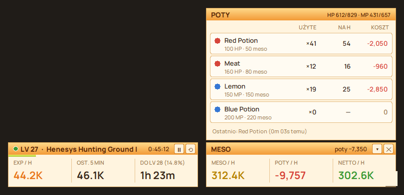

# MapleHUD

[Polski](README.md) · **English**

Overlay for **MapleStory Classic World**: EXP/h, meso/h, potion cost per hour and net profit, in two small panels on both sides of the game's bottom bar.



## Download and run

1. Go to **[Releases](../../releases/latest)** and download **MapleHUD.zip**.
2. Extract the whole folder (right-click the zip → *Extract All*).
3. Start the game (windowed or borderless works best).
4. Run **MapleHUD.exe**.

Windows may show *"Windows protected your PC"* because the program isn't digitally signed. Click **More info → Run anyway**.

Nothing to install. Requires Windows 10 or 11.

The language follows Windows (Polish or English). To change it: **right-click a panel → Język / Language**.

## What it shows

| Panel | Contents |
|---|---|
| **Left** | LV, map, EXP bar, EXP/h and % of level per hour, EXP/h over the last 5 min, time to next level, session time |
| **Right** | meso/h, potion cost/h, net/h (meso − potions) |
| **▴ Potions** | your pet and what it drinks (HP/MP, picked from a list), potions with icons: how many used, per hour, cost, current HP/MP |
| **▴ Maps** (left panel) | the 3 best maps: for each, its best run (EXP/h, % of your current level per hour, net/h, date). Under EXP/h: **15m** – the best 15 minutes from all runs on that map, i.e. what the spot can give at its best. Only runs longer than 15 min count, so short visits change nothing. Going to a shop or storage and coming back to the same map within 10 min doesn't end the run (neither do maps on the way, even with a few kills). The break – repot, walking back, waiting for a PQ – counts towards the run, like in a real grind. The current run is added live after 5 min (PQ stages are one map). On top, a level goal: EXP and time left to the chosen level – click to set it. |
| **■ End grind** | summary: time, maps, EXP and % of level, meso looted, potion cost, net. Saved to `sesje.csv`. ▶ starts a new grind. |

The panels fit the game window size (1366×768, 1920×1080 and others) and hide when the game isn't in front. MapleHUD closes by itself about 10 s after the game is closed.

## Where the data comes from

MapleHUD only **takes screenshots** and reads numbers from them, like OBS or Discord when streaming. It doesn't read game memory, change game files, inject code or press keys. It doesn't connect to the internet.

| Data | Source |
|---|---|
| **EXP** | the EXP bar at the bottom of the game |
| **Meso** | the meso counter in your inventory: open it at the start and every now and then (shop, storage and trade are ignored). After ending a grind or a pause "open inv" shows again: mesos picked up before the start don't count towards the new run. |
| **Potions** | the item count on the quickslot (exact, pet potions included); for potions not on the quickslot, HP/MP jumps on the status bar, e.g. +100 HP = Red Potion. Healing skills (HP up while MP is spent) aren't counted as potions. While the quickslot is hidden, HP/MP jumps are counted; once it shows again, the count catches up. A jump that matches no potion goes to **Other HP / Other MP** and costs as much as the cheapest potion (meso per HP/MP point). |
| **Map** | name from the minimap (the minimap must be open) |

Counting pauses by itself after 10 min without EXP (AFK, a longer break) and resumes on the next EXP; that time isn't counted. Leaving the game window, a shop, a PQ stage without mobs or waiting to enter a PQ doesn't stop the clock.

## Settings

**Right-click a panel**: start/pause, end grind, reset session, potion list, map comparison, level goal, **Pet: HP / MP potion**, opacity, level (when the bar shows only %), language, close.

**`potki.json`** (next to MapleHUD.exe; the keys are in Polish):

```json
"uzywane": ["Red Potion", "Orange Potion", "Meat", "Lemon", "Blue Potion"],
"potki": {
  "Blue Potion": {"hp": 0, "mp": 200, "cena": null}
}
```

- `uzywane` (used) – which potions to count. Best to list only the ones you actually use.
- `hp` / `mp` – how much it restores: a number or a percentage, e.g. `"35%"`.
- `cena` (price) – what you pay per item. `null` means the NPC shop price.
- `tolerancja_spadek` / `tolerancja_regen` – how much a jump may differ when you get hit or use a skill at the same moment.
- `mnoznik_hp` / `mnoznik_mp` – class potion bonus, e.g. `1.5`.
- `pomijaj_leczenie_skilli` – `true`: an HP jump while MP is spent is a skill, not a potion.
- `pet_hp` / `pet_mp` – what your pet drinks, `"Meat"` and `"Lemon"` by default (`null` = no pet). Easier to pick in the **▴ Potions** panel (pet, HP POT, MP POT). The pet drinks when you get hit, so any HP rise up to the potion's full value counts as its potion. If the pet's potion is also on the quickslot, it's counted exactly from there. Regen (the same HP rise every 10 s, e.g. a warrior's) is skipped.

After a change choose **right-click → Reload potki.json**.

## Results

In the `data` folder next to the exe:

- **`mapy.csv`** – each map (at least 2 min): time, EXP, EXP/h, % level/h, meso looted, potion cost, net and potions used. Opens in Excel.
- **`sesje.csv`** – the same for the whole grind, saved when you click ■, on reset and on close.
- **`sesja.log`** – detailed log: every recognized potion, meso changes, maps. Useful when something doesn't work.

The CSV and log files use Polish column names and a `;` separator.

## Limitations

- A potion drunk at the exact moment of a heavy hit may not be counted.
- When HP is full after a potion and several HP potions are on the list, the last recognized one is assumed.
- A cleric's heal may be counted as a pet potion or as Other HP. The pet's potions on a visible quickslot are counted exactly from the item count, so heals don't change them.
- The overlay must not cover the EXP bar or the meso counter in the inventory.
- Only one copy runs at a time.

## Building from source

Requires Python 3.14.

```bat
start.bat
build.bat
```

- `start.bat` – runs from source (creates `.venv` the first time).
- `build.bat` – builds `MapleHUD.exe` and `MapleHUD.zip` (PyInstaller).

| File | What it does |
|---|---|
| `maple_hud.py` | app, panels, logs |
| `lang.py` | English translations of the interface |
| `hpmp.py` | reads HP/MP from the status bar |
| `potcount.py` | recognizes potions from HP/MP jumps |
| `mesocount.py` | meso counter from the inventory |
| `winocr.py` | Windows OCR (map name) |
| `engine/` | EXP and meso reading |

## License

© 2026 tesem. All rights reserved – see [LICENSE.txt](LICENSE.txt).
The program includes open source components under the MIT license ([engine/LICENSE](engine/LICENSE)).
