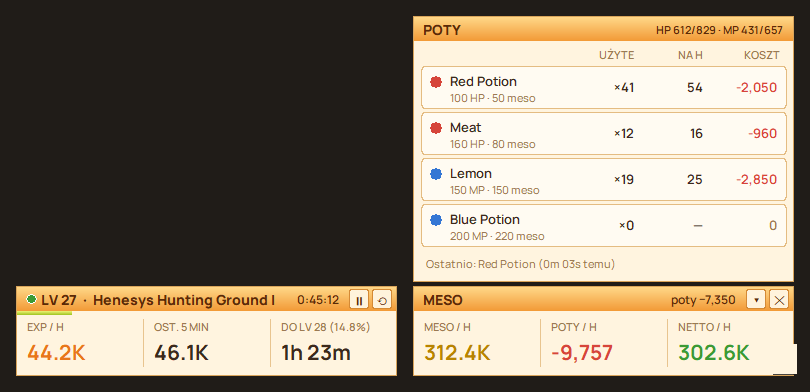

# MapleHUD

**Polski** · [English](README.en.md)

Overlay do **MapleStory Classic World**: EXP/h, meso/h, koszt potów na godzinę i zysk netto, w dwóch małych panelach po bokach dolnego paska gry.



## Pobieranie i uruchomienie

1. Wejdź w **[Releases](../../releases/latest)** i pobierz **MapleHUD.zip**.
2. Rozpakuj cały folder (prawy klik na zip → *Wyodrębnij wszystkie*).
3. Włącz grę (najlepiej w oknie albo bez ramki).
4. Odpal **MapleHUD.exe**.

Windows może pokazać *„System Windows ochronił komputer”*, bo program nie jest podpisany cyfrowo. Kliknij **Więcej informacji → Uruchom mimo to**.

Nic nie trzeba instalować. Wymagany Windows 10 lub 11.

Język zgodny z Windows (polski lub angielski). Zmiana: **prawy klik na panelu → Język / Language**.

## Co pokazuje

| Panel | Zawartość |
|---|---|
| **Lewy** | LV, mapa, pasek EXP, EXP/h i % levelu na godzinę, EXP/h z ostatnich 5 min, czas do następnego levelu, czas sesji. Przyciski: **⏱** minutnik, ▴ mapy, ▶/⏸ start/pauza, ■ koniec grindu. Gdy grind jest na pauzie, a EXP leci, nagłówek zmienia się na czerwone „PAUZA, a EXP leci ▶”. |
| **Prawy** | meso/h, koszt potów/h, netto/h (meso − poty). Gdy pet chyba pije inny pot MP niż ustawiony, w nagłówku pojawia się czerwone „pet pije …?”. |
| **▴ Poty** | Twój pet i co pije (HP/MP, wybór z listy), lista potów z ikonkami: ile zużytych, ile na godzinę, koszt, aktualne HP/MP. Na dole **meso w eq**: ile było na starcie runu i ile jest teraz. |
| **▴ Mapy** (lewy panel) | 3 najlepsze mapy: przy każdej najlepszy run (EXP/h, % obecnego levelu na godzinę, netto/h, data). Pod EXP/h: **15m** – najlepsze 15 min ze wszystkich runów na tej mapie, czyli ile da się wyciągnąć na tym spocie. Przy każdym runie % levelu, na którym był robiony, na godzinę. Runy krótsze niż 15 min są schowane (klik, żeby je pokazać), więc krótkie wejścia nic nie psują; starsze runy są na kolejnych stronach. Wyjście do sklepu czy storage i powrót na tę samą mapę w ciągu 10 min nie przerywa runu (mapy po drodze, nawet z paroma zabitymi mobami, też nie). Przerwa – repot, droga, czekanie na PQ – wlicza się do runu, tak jak w prawdziwym grindzie. Obecny run jest dopisany na żywo po 5 min (etapy PQ to jedna mapa). Na górze cel levelu: ile EXP i czasu do wybranego poziomu – kliknij, żeby ustawić. Pod nim **DZIŚ**: cały EXP z dzisiaj, czas grania, średnie EXP/h i meso na plus (po odjęciu potów). **Klik w mapę** rozwija wszystkie jej runy: data i godzina, czas, LV, EXP/h, najlepsze 15 min i meso na plus za run, a nad nimi suma (ile runów, łączny czas, średnie EXP/h, meso). Drugi klik zwija. |
| **⏱ Minutnik** | dla map, na których trzeba co jakiś czas zbierać dropy: klik ⏱ startuje odliczanie (domyślnie 1:30) w okienku przy quickslocie, po czasie pulsuje „ZBIERAJ!” i (opcjonalnie) słychać sygnał. Klik w okienko liczy od nowa. Długość, stop i dźwięk: **prawy klik → Minutnik (zbieranie dropów)**. Klik nie zabiera klawiatury grze. |
| **Final Attack** (łucznik) | gdy w prawym górnym rogu wisi buff Final Attack, przy lewym dolnym rogu quickslota pojawia się jego ikonka z pulsującą ramką; znika chwilę po zużyciu buffa. |
| **■ Koniec grindu** | podsumowanie: czas, mapy, EXP i % levelu, zebrane meso, meso w eq (start → koniec), koszt potów, netto. Zapisuje do `sesje.csv`. ▶ zaczyna nowy grind. |

Panele same dopasowują się do rozmiaru okna gry (1366×768, 1920×1080 i inne) i chowają się, gdy gra nie jest na wierzchu. Po wyłączeniu gry MapleHUD zamyka się sam (po ok. 10 s).

## Skąd bierze dane

MapleHUD tylko **robi zrzuty ekranu** i odczytuje z nich liczby, tak jak OBS albo Discord przy streamowaniu. Nie czyta pamięci gry, nie zmienia jej plików, nie wstrzykuje kodu i nie wciska klawiszy. Nie łączy się z internetem.

| Dane | Skąd |
|---|---|
| **EXP** | pasek EXP na dole gry. EXP zdobyty w mieście (nagrody za questy) nie liczy się do grindu. |
| **Meso** | licznik meso w ekwipunku: otwórz eq co jakiś czas. W trakcie grindu (także na pauzie) każdy przyrost meso to zarobek, również sprzedaż dropów w sklepie; wydatki (np. zakup potów) się nie liczą, bo poty liczone są przy piciu. Storage i trade są pomijane. Meso/h liczone jest za czas do ostatniego otwarcia eq, więc nie spada między otwarciami. „otwórz eq” pokazuje się tylko, gdy meso nie było jeszcze widziane od włączenia programu. |
| **Poty** | liczba sztuk na quickslocie (dokładne, także poty od peta; chwilowo wyszarzona ikonka po wypiciu niczego nie gubi), a dla potów spoza quickslota skoki HP/MP na pasku statusu, np. +100 HP = Red Potion. Leczenie ze skilli (HP w górę przy zużyciu many) nie jest liczone jako pot. Gdy quickslot jest schowany, liczą się skoki HP/MP, a po jego pokazaniu liczba się wyrównuje. Niepewna cyfra na quickslocie (np. ostatnia cyfra na ikonce pota) nie jest zgadywana: wtedy liczą się skoki HP/MP, aż liczba będzie czytelna. Skok, który nie pasuje do żadnego pota, trafia do **Inne HP / Inne MP** i kosztuje tyle, co najtańszy pot (meso za punkt HP/MP). |
| **Mapa** | nazwa z minimapy (minimapa musi być otwarta) |

Liczenie pauzuje się samo po 10 min bez EXP (AFK, dłuższa przerwa) i rusza przy następnym EXP; ten czas bez EXP nie jest liczony. Wyjście z okna gry, sklep, etap PQ bez mobów czy czekanie na wejście do PQ nie zatrzymują czasu.

## Ustawienia

**Prawy klik na panelu**: start/pauza, koniec grindu, reset sesji, lista potów, porównanie map, cel levelu, **Minutnik (zbieranie dropów)**, **Pet: pot HP / pot MP** (co pije pet), przezroczystość, poziom (gdy pasek pokazuje tylko %), język, zamknij.

**`potki.json`** (obok MapleHUD.exe):

```json
"uzywane": ["Red Potion", "Orange Potion", "Meat", "Lemon", "Blue Potion"],
"potki": {
  "Blue Potion": {"hp": 0, "mp": 200, "cena": null}
}
```

- `uzywane` – które poty liczyć. Lepiej wpisać tylko te, których faktycznie używasz.
- `hp` / `mp` – ile przywraca: liczba albo procent, np. `"35%"`.
- `cena` – ile płacisz za sztukę. `null` oznacza cenę w sklepie NPC.
- `tolerancja_spadek` / `tolerancja_regen` – o ile skok może się różnić, gdy w tej samej chwili dostaniesz hita albo użyjesz skilla.
- `mnoznik_hp` / `mnoznik_mp` – bonus klasy do potów, np. `1.5` dla warriora z Improved HP Recovery.
- `pomijaj_leczenie_skilli` – `true`: skok HP przy zużyciu many to skill, nie pot.
- `pet_hp` / `pet_mp` – co pije pet, domyślnie `"Meat"` i `"Lemon"` (`null` = brak peta). Wygodniej wybrać w panelu **▴ Poty** (pet, POT HP, POT MP). Pet pije w chwili trafienia, więc każdy wzrost HP do pełnej wartości pota liczy się jako jego pot. Gdy pot peta jest też na quickslocie, liczony jest dokładnie stamtąd. Regen (ten sam wzrost HP co 10 s, np. u warriora) jest pomijany.

Po zmianie wybierz **prawy klik → Wczytaj potki.json**.

## Wyniki

W folderze `data` obok exe:

- **`mapy.csv`** – każda mapa (co najmniej 2 min): czas, EXP, EXP/h, % levelu/h, zebrane meso, koszt potów, netto, zużyte poty, najlepsze 15 min oraz **meso/h** i **netto/h** (`meso_h`, `netto_h`). Otwierasz w Excelu (zamknij plik przed grą, inaczej Windows zablokuje zapis).
- **`sesje.csv`** – to samo dla całego grindu, zapisywane po kliknięciu ■, przy resecie i zamknięciu.
- **`sesja.log`** – szczegółowy log: każdy rozpoznany pot, zmiany meso, mapy, start/pauza. Przydatny, gdy coś nie działa.
- **`buff_debug/`** – ostatnie 40 wycinków ekranu z chwili pojawienia się Final Attack (z wynikiem dopasowania w nazwie), na wypadek fałszywych trafień.

## Ograniczenia

- Pot wypity dokładnie w chwili mocnego trafienia może nie zostać policzony.
- Gdy HP jest pełne po pocie, a na liście jest kilka potów HP, przyjmowany jest ostatnio rozpoznany.
- Heal od clerica może zostać policzony jako pot peta albo jako Inne HP. Poty peta na widocznym quickslocie liczą się dokładnie z licznika sztuk, więc heal ich nie zmienia.
- Overlay nie może zasłaniać paska EXP ani licznika meso w ekwipunku.
- Działa jedna kopia programu naraz.

## Budowanie ze źródeł

Wymagany Python 3.14.

```bat
start.bat
build.bat
```

- `start.bat` – uruchamia ze źródeł (za pierwszym razem tworzy `.venv`).
- `build.bat` – buduje `MapleHUD.exe` i `MapleHUD.zip` (PyInstaller).

| Plik | Co robi |
|---|---|
| `maple_hud.py` | aplikacja, panele, logi |
| `lang.py` | angielskie tłumaczenie interfejsu |
| `hpmp.py` | odczyt HP/MP z paska statusu |
| `potcount.py` | rozpoznawanie potów ze skoków HP/MP |
| `mesocount.py` | licznik meso z ekwipunku |
| `winocr.py` | OCR Windows (nazwa mapy) |
| `engine/` | odczyt EXP i meso |

## Licencja

© 2026 tesem. Wszelkie prawa zastrzeżone – zob. [LICENSE.txt](LICENSE.txt).
Program zawiera komponenty open source na licencji MIT ([engine/LICENSE](engine/LICENSE)).
