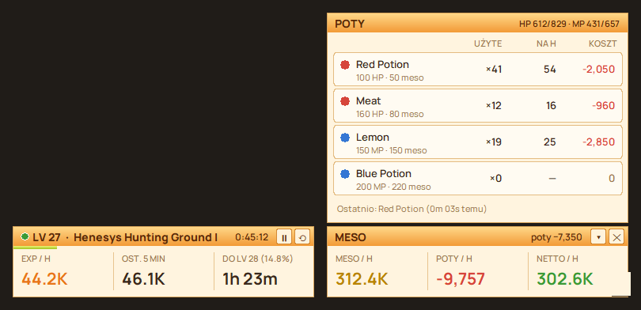

# MapleHUD

Overlay do **MapleStory Classic World**: EXP/h, meso/h, koszt potów na godzinę i zysk netto, w dwóch małych panelach po bokach dolnego paska gry.



## Pobieranie i uruchomienie

1. Wejdź w **[Releases](../../releases/latest)** i pobierz **MapleHUD.zip**.
2. Rozpakuj cały folder (prawy klik na zip → *Wyodrębnij wszystkie*).
3. Włącz grę (najlepiej w oknie albo bez ramki).
4. Odpal **MapleHUD.exe**.

Windows może pokazać *„System Windows ochronił komputer”*, bo program nie jest podpisany cyfrowo. Kliknij **Więcej informacji → Uruchom mimo to**.

Nic nie trzeba instalować. Wymagany Windows 10 lub 11.

## Co pokazuje

| Panel | Zawartość |
|---|---|
| **Lewy** | LV, mapa, pasek EXP, EXP/h i % levelu na godzinę, EXP/h z ostatnich 5 min, czas do następnego levelu, czas sesji |
| **Prawy** | meso/h, koszt potów/h, netto/h (meso − poty) |
| **▴ Poty** | lista potów z ikonkami: ile zużytych, ile na godzinę, koszt, aktualne HP/MP |
| **■ Koniec grindu** | podsumowanie: czas, mapy, EXP i % levelu, zebrane meso, koszt potów, netto. Zapisuje do `sesje.csv`. ▶ zaczyna nowy grind. |

Panele same dopasowują się do rozmiaru okna gry (1366×768, 1920×1080 i inne) i chowają się, gdy gra nie jest na wierzchu. Po wyłączeniu gry MapleHUD zamyka się sam (po ok. 10 s).

## Skąd bierze dane

MapleHUD tylko **robi zrzuty ekranu** i odczytuje z nich liczby, tak jak OBS albo Discord przy streamowaniu. Nie czyta pamięci gry, nie zmienia jej plików, nie wstrzykuje kodu i nie wciska klawiszy. Nie łączy się z internetem.

| Dane | Skąd |
|---|---|
| **EXP** | pasek EXP na dole gry |
| **Meso** | licznik meso w ekwipunku: otwórz eq na starcie i co jakiś czas (zakupy w sklepie, storage i trade są pomijane) |
| **Poty** | liczba sztuk na quickslocie (dokładne, także poty od peta), a dla potów spoza quickslota skoki HP/MP na pasku statusu, np. +100 HP = Red Potion. Leczenie ze skilli (HP w górę przy zużyciu many) nie jest liczone jako pot. |
| **Mapa** | nazwa z minimapy (minimapa musi być otwarta) |

Liczenie pauzuje się samo po 15 s bez EXP i rusza przy następnym EXP.

## Ustawienia

**Prawy klik na panelu**: start/pauza, koniec grindu, reset sesji, lista potów, przezroczystość, poziom (gdy pasek pokazuje tylko %), zamknij.

**`potki.json`** (obok MapleHUD.exe):

```json
"uzywane": ["Red Potion", "Orange Potion", "Meat", "Lemon", "Blue Potion"],
"potki": {
  "Blue Potion": {"hp": 0, "mp": 200, "cena": null}
}
```

- `uzywane` – które poty liczyć. Lepiej wpisać tylko te, których faktycznie używasz.
- `hp` / `mp` – ile przywraca: liczba albo procent, np. `"35%"`.
- `cena` – ile płacisz za sztukę. `null` oznacza cenę w sklepie NPC.
- `tolerancja_spadek` / `tolerancja_regen` – o ile skok może się różnić, gdy w tej samej chwili dostaniesz hita albo użyjesz skilla.
- `mnoznik_hp` / `mnoznik_mp` – bonus klasy do potów, np. `1.5` dla warriora z Improved HP Recovery.
- `pomijaj_leczenie_skilli` – `true`: skok HP przy zużyciu many to skill, nie pot.

Po zmianie wybierz **prawy klik → Wczytaj potki.json**.

## Wyniki

W folderze `data` obok exe:

- **`mapy.csv`** – każda mapa (co najmniej 2 min): czas, EXP, EXP/h, % levelu/h, zebrane meso, koszt potów, netto i zużyte poty. Otwierasz w Excelu.
- **`sesje.csv`** – to samo dla całego grindu, zapisywane po kliknięciu ■, przy resecie i zamknięciu.
- **`sesja.log`** – szczegółowy log: każdy rozpoznany pot, zmiany meso, mapy. Przydatny, gdy coś nie działa.

## Ograniczenia

- Pot wypity dokładnie w chwili mocnego trafienia może nie zostać policzony.
- Gdy HP jest pełne po pocie, a na liście jest kilka potów HP, przyjmowany jest ostatnio rozpoznany.
- Heal od clerica o wartości zbliżonej do pota może zostać policzony jako pot.
- Overlay nie może zasłaniać paska EXP ani licznika meso w ekwipunku.
- Działa jedna kopia programu naraz.

## Budowanie ze źródeł

Wymagany Python 3.14.

```bat
start.bat
build.bat
```

- `start.bat` – uruchamia ze źródeł (za pierwszym razem tworzy `.venv`).
- `build.bat` – buduje `MapleHUD.exe` i `MapleHUD.zip` (PyInstaller).

| Plik | Co robi |
|---|---|
| `maple_hud.py` | aplikacja, panele, logi |
| `hpmp.py` | odczyt HP/MP z paska statusu |
| `potcount.py` | rozpoznawanie potów ze skoków HP/MP |
| `mesocount.py` | licznik meso z ekwipunku |
| `winocr.py` | OCR Windows (nazwa mapy) |
| `engine/` | odczyt EXP i meso |

## Licencja

© 2026 tesem. Wszelkie prawa zastrzeżone – zob. [LICENSE.txt](LICENSE.txt).
Program zawiera komponenty open source na licencji MIT ([engine/LICENSE](engine/LICENSE)).
